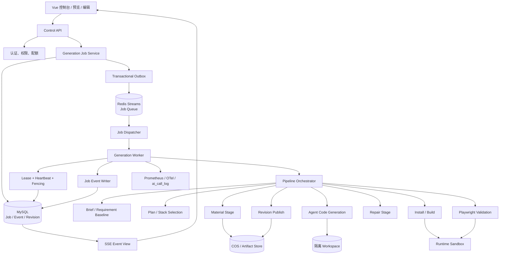
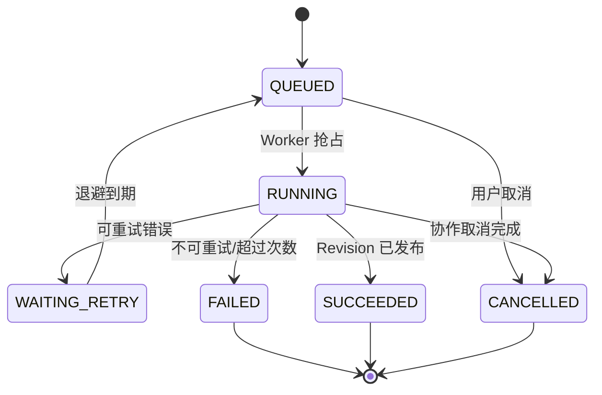

# 计划书：零代码生成平台可扩展架构重构

> 日期：2026-10-22
> 状态：Phase 0 数据契约与固定评估集 + Phase 1～3 已实施；Phase 4～6 基础能力已落地，
> React/Next 执行适配、模板 Golden 门禁与独立容器沙箱尚未完成
> 目标：在不推翻现有 Agent、记忆、图片和验证能力的前提下，把平台从“单实例同步生成器”演进为
> **任务可恢复、产物可追踪、运行时可选、模板可组合、Worker 可横向扩展**的生成平台。

---

## 一、结论先行

### 1. 最值得优先重构的不是模型接入，而是执行内核

当前系统的核心流程仍然带有明显的早期特征：

```text
GET /stream
→ 返回 SseEmitter
→ 内存 Map 抢占 appId
→ 线程池直接生成
→ 直接覆盖当前工程目录
→ SSE 推送完成
```

这套结构能快速做出可用产品，但无法自然支持：

- 任务断线和恢复；
- 多实例部署；
- 生成版本、回滚和差异比较；
- 生成、修复、验证、部署的统一追踪；
- 任意技术栈和模板组合；
- 100 个以上并发生成任务；
- 从失败阶段继续执行。

因此第一优先级是：

> **把生成执行内核重构成持久化 Generation Job + 隔离 Workspace + Release Revision + Artifact Graph。**

### 2. 第二优先级是 StackProfile 与 Template Bundle

当前 HTML / 多文件 / Vue 是固定 `CodeGenTypeEnum`。模型并没有真正自由选择技术栈，
构建、预览和部署方式也按类型写死在业务代码中。

下一阶段应抽象：

```text
ProjectRuntime / StackProfile
+ Composable Template Bundle
```

模型从受支持的运行时中选择，不能任意安装依赖或执行任意命令。

### 3. 保留现有高质量模块，不做大爆炸重写

以下能力继续保留：

- `AgentToolLoop`：统一预算、取消、流式聚合、工具执行；
- `SiteRepairAgent` / `SiteModifyAgent`：职责拆分；
- `AppSpecService`、`AgentMemoryService`、`ContextCompressionService`；
- `ImageMaterialPlanner`、`ImageCuratorAgent`、响应式图片链路；
- `RenderVerifier` 的检测思路；
- 手动编辑快照与重放；
- 低基数指标 + 高基数明细的可观测性分层。

重构方式是“外围加壳、逐步替换”，不是把所有 Agent 重新写一遍。

---

## 二、当前架构基线

### 1. 当前主要调用链

```text
AiChatController
  → AiCodeGeneratorFacade
    → GenerationTaskRegistry（内存互斥）
    → vueThreadPoolExecutor
      → VueProjectAgent
        → AppSpecService
        → AgentMemoryService / ContextCompressionService
        → ImageMaterialPlanner / ImageCuratorAgent
        → AgentToolLoop
          → 工具集合
        → RenderVerifier
          → 异步 SiteRepairAgent
      → callback(done)
  → SSE 返回前端
```

### 2. 当前优点

| 模块 | 当前价值 |
|---|---|
| AgentToolLoop | 已经统一工具循环、预算、取消、流式事件 |
| Agent 拆分 | 生成、修复、修改边界已初步清晰 |
| 记忆 | Redis 热窗口、MySQL 回源、结构化摘要已实现 |
| 图片 | 多主题 query + 视觉 Curator + 原图响应式档位 |
| 验证 | 三档视口检测、问题清单、异步修复 |
| 可观测性 | Prometheus 低基数指标 + MySQL 调用明细 |

### 3. 当前核心问题

| 问题 | 当前表现 | 长期影响 |
|---|---|---|
| 请求与执行耦合 | SSE GET 直接触发生成 | 断线、重连、恢复语义复杂 |
| 内存锁 | `ConcurrentHashMap<appId, task>` | 多实例失效 |
| 状态分散 | app 状态、Registry、renderFixStatus 分离 | 无法统一追踪任务 |
| 直接写 live 目录 | 新生成覆盖旧文件 | 无回滚、无版本 diff、旧任务可能覆盖 |
| 固定类型枚举 | HTML / Multi / Vue 写死 | 加 Next、Astro、React 成本高 |
| 模板未产品化 | Prompt 与文件结构分散 | 无法组合、版本化和评估 |
| 产物无统一 ID | 文件、图片、报告散落 | 无法回答“这版用了哪些素材和验证” |
| 安全边界有限 | 本地进程、应用层路径检查 | 多租户和生产环境风险高 |
| 评估不稳定 | 真实生成依赖人工检查 | 非确定性回归困难 |

---

## 三、目标原则

### 1. 控制面与执行面分离

- 控制面：API、权限、配额、Job、事件、版本、发布；
- 执行面：Agent、工具、素材、构建、验证、修复。

第一版仍可部署在同一个 Spring Boot 应用里，但接口和生命周期必须分开，
后续可以无业务改动地拆 Worker。

### 2. 数据库是任务真相源

- Job 状态、阶段、租约、事件、Revision 必须持久化；
- Redis 只做热缓存、投递和短期协调；
- SSE 只是事件视图，不是任务本身；
- 页面关闭、连接断开不能影响 Job 执行。

### 3. 产物不可变，发布原子化

- 一次执行写一个独立 Revision；
- Revision 完成前不覆盖当前版本；
- 发布只切换 `currentRevision`；
- 失败和取消不破坏当前线上应用。

### 4. 模型自由必须在受控能力目录内

- 模型可选择 StackProfile、模板组合和页面结构；
- 不能自由执行命令；
- 不能引入任意依赖；
- 不能直接访问宿主机文件系统；
- 所有能力来自版本化注册表。

### 5. 默认可观测、可回滚、可重放

每个阶段都应能回答：

- 输入是什么；
- 输出是什么；
- 用了哪个模型/Prompt/模板版本；
- 失败在哪里；
- 是否可以安全重试；
- 是否产生了副作用。

---

## 四、目标架构



### 1. 逻辑分层

```text
platform/
  job/                 Job、Attempt、Event、Lease
  queue/               投递与消费抽象
  artifact/            Artifact、Revision、Manifest
  workspace/           隔离工作区生命周期
  runtime/             StackProfile、Build、Preview、Deploy
  template/            Template Bundle、组合与版本
  security/            URL、路径、命令、配额、沙箱

pipeline/
  stage/               标准 Stage 接口
  brief/
  plan/
  material/
  generate/
  validate/
  repair/
  publish/

agent/
  loop/                AgentToolLoop
  generate/            生成 Agent
  repair/              修复 Agent
  modify/              修改 Agent
  memory/
  tools/
```

这是目标目录，不在第一阶段一次性搬迁。

### 2. 扩展点契约

高扩展性不来源于“多写几个 if”，而来源于稳定的端口和适配器：

| 新增能力 | 稳定接口 | 新增方式 | 不应修改 |
|---|---|---|---|
| 新框架/构建方式 | `StackProfile` | 新增 Profile 适配器 | Job、API、Artifact |
| 新视觉模板 | `TemplateBundle` | 新增可组合模板包 | AgentToolLoop |
| 新模型供应商 | `ModelGateway` | 新增模型适配器 | Pipeline Stage |
| 新工具 | `GenerationToolProvider` | 注册 ToolCallback + RiskPolicy | 生成主流程 |
| 新验证类型 | `ValidationStage` | 新增 Validator | Job 状态机 |
| 新队列 | `JobQueue` | 新增 Redis/Rabbit/Kafka 实现 | JobService |
| 新产物存储 | `ArtifactStore` | 本地/COS/S3 实现 | Stage 业务 |
| 新部署目标 | `DeployProvider` | 新增部署适配器 | Revision/Publish 核心 |
| 新通知渠道 | `JobEventSink` | SSE/Webhook/邮件适配器 | Worker |
| 新 Prompt/模板版本 | `VersionedCatalog` | 新版本资源 + hash | 已发布 revision |
| 新技能 | `SkillDefinition` | 技能包 + 能力声明 + 风险策略 | AgentToolLoop |
| 新素材类型 | `AssetProcessor` | 图片/视频/音频/3D 处理器 | Asset Registry |
| 后端数据服务 | `DataCapabilityProvider` | 表结构、查询策略与配额实现 | 前端生成 Stage |
| 后端函数 | `FunctionRuntime` | 函数打包、部署、调用适配器 | 平台 API |
| 密钥管理 | `SecretProvider` | Vault/KMS/云密钥实现 | 生成的业务代码 |
| 流量分析 | `AnalyticsSink` + `AnalyticsQueryPort` | 事件采集与聚合实现 | Job/Pipeline |
| 团队与社区 | `Principal` + `AclPolicy` | 组织/RBAC/公开可见性适配 | 业务用例 |

依赖方向必须固定：

```text
Controller / Worker
        ↓
Pipeline / Stage
        ↓
Domain Ports
        ↑
Infrastructure Adapters
```

禁止 Domain/Stage 反向依赖 Controller、具体 Redis 客户端、具体 COS SDK 或 `CodeGenTypeEnum`。

---

## 五、核心领域模型

### 1. GenerationJob

```text
id                   Job 唯一 ID
workspaceId          所属团队/工作区
appId                目标应用
requestedBy          发起用户
requestType          generate / modify / repair
idempotencyKey       客户端幂等键
requestHash          请求内容摘要
status               QUEUED / RUNNING / WAITING / SUCCEEDED / FAILED / CANCELLED
currentStage         MATERIAL / GENERATE / BUILD / VERIFY / REPAIR / PUBLISH
stackProfileId       选择的运行时
templateVersionId    模板组合版本
baseRevisionId       续接任务起点
candidateRevisionId  本次生成版本
publishedRevisionId  当前发布版本
priority             用户任务优先级
visibility           私有 / 团队 / 公开，默认私有
attempt              当前执行次数
maxAttempts          最大重试次数
leaseOwner           当前 Worker
leaseExpiresAt       租约过期时间
fencingToken         单调递增写入凭证
createdAt / updatedAt
```

### 2. Job 状态机



状态约束：

- `SUCCEEDED` 必须存在完整 Revision 或明确的无需发布产物；
- 只有当前 fencing token 的 Worker 可以推进状态；
- 取消不是直接杀线程，而是 `CANCEL_REQUESTED` + 阶段边界协作退出；
- 重试必须从 Stage checkpoint 开始，不能盲目重跑所有副作用。

### 3. JobEvent

事件日志用于 SSE 重放和审计：

```text
seq                  单 Job 内单调递增
jobId
type                 stage_started / progress / artifact_created / stage_failed /
                     repair_started / publish_completed / cancelled
stage
payload              JSON 文本
visibility           user / internal
createdAt
```

SSE 请求带 `Last-Event-ID` 时，从 `seq + 1` 重放，不重新创建 Job。

### 4. Attempt

每次 Worker 执行记一条 Attempt：

```text
jobId
attemptNo
workerId
startedAt
finishedAt
failureType
failureMessage
checkpointStage
```

用于区分“任务本身失败”和“某个 Worker/实例故障”。

### 5. Lease

第一版使用数据库租约即可：

```text
ownerId
fencingToken
expiresAt
heartbeatAt
```

Worker 每 10～15 秒续租。超过租约后，新 Worker 可以接管，并推进 fencing token。

文件写入、DB 状态更新和最终发布都校验 fencing token，避免暂停恢复的旧实例覆盖新任务。

---

## 六、API 设计

### 1. 创建生成 Job

```http
POST /api/v1/apps/{appId}/generation-jobs
Idempotency-Key: <client-generated-key>
Content-Type: application/json
```

```json
{
  "message": "生成一个摄影作品照片墙网站",
  "reasoningLevel": "standard",
  "stackPreference": "auto",
  "templateHint": "photography-editorial",
  "baseRevisionId": null
}
```

返回：

```http
202 Accepted
```

```json
{
  "jobId": "469...",
  "status": "QUEUED",
  "eventsUrl": "/api/v1/generation-jobs/469.../events"
}
```

同一 `appId + Idempotency-Key` 重复请求返回同一个 Job。
同一 app 已有运行 Job 时，可按业务策略拒绝或加入“下一版本队列”，不能启动第二个写入任务。

### 2. 查询和订阅

```text
GET  /api/v1/generation-jobs/{jobId}
GET  /api/v1/generation-jobs/{jobId}/events?after=0
POST /api/v1/generation-jobs/{jobId}/cancel
GET  /api/v1/apps/{appId}/revisions
POST /api/v1/apps/{appId}/revisions/{revisionId}/publish
POST /api/v1/apps/{appId}/revisions/{revisionId}/rollback
```

SSE 只负责读事件：

```text
event: stage
id: 18
data: {"stage":"VERIFY","status":"RUNNING"}
```

断线重连、刷新页面、切走页面都只影响订阅，不会产生新 Job。

### 3. 兼容现有接口

迁移期保留旧 `/ai/chat/stream`：

```text
旧接口 → 内部创建新 Job → 将 JobEvent 适配成旧 SSE 格式
```

前端逐步切到新 Job API；旧接口只作为兼容层，不再直接驱动 Agent。

---

## 七、执行流水线

### 1. Stage 接口

建议每个阶段有显式输入、输出和副作用声明：

```java
public interface GenerationStage<I, O> {
    StageId id();

    Set<ArtifactType> requires();

    Set<ArtifactType> produces();

    Class<I> inputType();

    O execute(StageContext context, I input);

    boolean retryable(RuntimeException error);
}
```

StageContext 至少包含：

```text
jobId
appId
attempt
baseRevision
candidateRevision
workspace
artifactStore
fencingToken
cancellationToken
eventSink
traceContext
```

不建议每个 Stage 自己直接访问全局 Bean 和磁盘路径；应通过上下文提供的端口访问能力。

### 2. 默认流水线

```text
VALIDATE_REQUEST
→ BUILD_REQUIREMENT_BASELINE
→ BUILD_GENERATION_PLAN
→ SELECT_STACK_AND_TEMPLATE
→ PREPARE_MATERIALS
→ SCAFFOLD_PROJECT
→ GENERATE_SOURCE
→ STATIC_VALIDATE
→ BUILD
→ RENDER_VALIDATE
→ VISUAL_REVIEW
→ REPAIR
→ FINAL_VALIDATE
→ CREATE_REVISION
→ PUBLISH
```

不是所有任务都执行全部阶段：

- 纯 HTML 可以跳过 install；
- 图片需求可以跳过 Material；
- 局部修改从 `baseRevision` 加载，不重新 scaffold；
- 修复任务只执行读取、patch、build、verify；
- StackProfile 可以声明 skip 条件。

### 3. 并行规则

允许并行：

- 图片候选下载、压缩和上传；
- 不同验证维度（结构、网络、console）；
- 多个模板方向的低成本 mockup；
- 多个独立 artifact hash/upload。

禁止并行：

- 同一 Workspace 的源码写入；
- 同一 app 的 publish；
- 同一 revision 的 verify-after 与源码修改；
- 同一文件的手动编辑重放。

### 4. 重试规则

| 阶段 | 可重试 | 说明 |
|---|---|---|
| 素材下载 | 是 | 网络/限流，按查询和 URL 幂等 |
| 模型调用 | 条件 | 429/超时/截断可重试，非法结构先修复再重试 |
| 工具写文件 | 是 | 写当前 revision 的临时文件，幂等覆盖 |
| build | 是 | 构建失败可交修复，不建议无限原样重试 |
| render | 是 | 浏览器资源失败可重启浏览器 |
| repair | 是 | 必须限制轮次 |
| publish | 是 | 必须 fencing + 原子指针 CAS |

---

## 八、Artifact Graph 与版本发布

### 1. Artifact 类型

```text
REQUIREMENT_BASELINE
GENERATION_PLAN
TEMPLATE_SELECTION
MATERIAL_MANIFEST
SOURCE_TREE
BUILD_OUTPUT
RENDER_REPORT_BEFORE
REPAIR_PATCH
RENDER_REPORT_AFTER
PREVIEW_BUNDLE
DEPLOY_BUNDLE
```

每个 Artifact 至少有：

```text
id
jobId
workspaceId
revisionId
type
scope                JOB / PROJECT / WORKSPACE / SYSTEM / PUBLIC
ownerId
visibility
license
uri
sha256
size
mimeType
metadata
createdAt
```

### 2. Revision Manifest

```json
{
  "revision": 42,
  "jobId": "469...",
  "baseRevision": 41,
  "stackProfile": "next-static",
  "template": {
    "id": "photography-editorial",
    "version": "3"
  },
  "artifacts": {
    "requirements": "sha256:...",
    "plan": "sha256:...",
    "materials": "sha256:...",
    "sourceTree": "sha256:...",
    "buildOutput": "sha256:...",
    "verifyBefore": "sha256:...",
    "verifyAfter": "sha256:..."
  },
  "status": "VALIDATED"
}
```

### 3. 目录结构

```text
tmp/runs/{jobId}/
  workspace/
    src/
    package.json
  artifacts/
    requirement-baseline.json
    plan.json
    materials.json
    verify-before.json
    verify-after.json
    manifest.json

apps/{appId}/
  revisions/{revision}/source/
  revisions/{revision}/build/
  revisions/{revision}/manifest.json
```

数据库只保存当前 revision 指针，不依赖软链接兼容 Windows：

```text
app.currentRevision = 42
```

读取源码时统一通过 `RevisionWorkspaceService`，不直接拼接 app 当前目录。

### 4. 原子发布

```sql
UPDATE app
SET currentRevision = :candidateRevision
WHERE id = :appId
  AND (
    currentRevision = :expectedCurrentRevision
    OR :forceReplace = true
  );
```

最终发布还要校验：

- candidate revision 的 fencing token 仍有效；
- final verification 通过；
- artifact manifest 完整；
- build bundle 可读取。

---

## 九、StackProfile 抽象

### 1. 目标

模型不应自由决定：

```text
用什么包管理器
执行什么 shell
输出到哪个目录
怎么启动预览
如何部署
```

模型只选择受支持的 `stackProfileId`。

### 2. 接口草案

```java
public interface StackProfile {
    String id();

    String displayName();

    Set<String> allowedDependencies();

    ProjectScaffoldResult scaffold(TemplateBundle bundle, Workspace workspace);

    CommandPlan install(Workspace workspace);

    CommandPlan build(Workspace workspace);

    Path outputDirectory(Workspace workspace);

    PreviewDescriptor createPreview(Workspace workspace, BuildResult build);

    DeployDescriptor deploy(PublishContext context);

    StackValidationResult validate(Workspace workspace);
}
```

`CommandPlan` 只能来自 Profile 注册表，模型不能传任意命令。

### 3. 首批 Profile

| Profile | 目标 | 阶段 |
|---|---|---|
| `html-static` | 现有单页模式 | P1 兼容 |
| `vue-vite` | 现有 Vue3 模式 | P1 兼容 |
| `react-vite-ts` | 复杂交互 SPA | P2 |
| `next-static-export` | SEO、多路由、高级动效 | P2 |
| `astro-content` | 内容/摄影/营销站 | P3 |

第一版 Next.js 只做静态导出，避免引入每个应用一个 Node SSR 进程的运维复杂度。

### 4. 模型选择协议

模型输出：

```json
{
  "stackProfileId": "next-static-export",
  "reason": "需要多页面、SEO 和滚动叙事",
  "requiredCapabilities": ["routing", "seo", "image-gallery", "motion"],
  "templateModules": [
    "brand-editorial",
    "photography-gallery",
    "cinematic-motion"
  ]
}
```

程序必须校验：

- profile 是否存在；
- template module 是否兼容；
- 依赖是否在 allowlist；
- 用户是否选择锁定技术栈；
- 当前 Worker 是否支持该 profile。

校验失败时回到 Plan 阶段要求模型重新选择，不允许自由降级成一个不兼容方案。

---

## 十、Template Bundle 与组合

### 1. 模板不再只是 Prompt + 空工程

```text
templates/
  {bundleId}/
    manifest.yaml
    prompts/
    design/tokens.json
    design/art-direction.md
    sections/
    components/
    content/schema.json
    motion/
    assets/
    validation/rubric.yaml
    golden/screenshots/
```

### 2. 模板模块类型

```text
brand-style        品牌与设计语言
page-archetype     整站信息架构
section-pack       hero/gallery/pricing/faq 等区块
component-pack     卡片、筛选器、光箱、表单
motion-pack        GSAP 动效叙事
content-schema     内容模型与示例
stack-adapter      某运行时下的实现
quality-pack       验收标准与 golden screenshots
```

最终模板组合：

```text
editorial-brand
+ photography-gallery
+ cinematic-motion
+ next-static-export
```

### 3. EffectiveTemplate

组合后生成不可变的 `EffectiveTemplate`：

```json
{
  "bundleHash": "sha256:...",
  "modules": [
    {"id": "editorial-brand", "version": "2"},
    {"id": "photography-gallery", "version": "4"},
    {"id": "cinematic-motion", "version": "1"}
  ],
  "stackProfile": "next-static-export",
  "tokens": {},
  "sections": [],
  "allowedDependencies": []
}
```

Revision 记录 bundleHash，确保以后能复现。

### 4. 渐进式加载

不要把整个模板塞进 Prompt：

1. Plan 阶段只读 manifest 摘要；
2. 选择模块后注入目标、约束和 token；
3. 代码 Agent 按需读取具体 section/component 文件；
4. 大型示例只保留索引，使用 `readFile` 取用。

---

## 十一、Requirement Baseline 与上下文

### 1. 不再把“第一句话”当唯一需求

新增：

```text
RequirementBaseline
  objective
  targetUsers
  mustHave
  constraints
  excluded
  acceptance
  decisions
  sourceMessageIds
  updatedAt
```

每个用户请求在进入生成前执行 Requirement Update：

- 全局目标/必须功能/禁止项：更新基线；
- 局部样式修改：作为 revision change，不污染基线；
- 明确撤销：更新或删除基线项；
- 问答：不进入基线。

### 2. 上下文区域

```text
Zone A：静态系统规则      不可裁剪
Zone B：需求基线          不可裁剪
Zone C：应用规格/文件索引  确定性更新
Zone D：近期对话           token 预算
Zone E：旧对话摘要         可重建
Zone F：工具历史           可选省略
Zone G：当前请求           不可裁剪
```

ContextAssembler 输出固定结构，每个 Zone 单独计量 token。

### 3. 与现有记忆兼容

- 保留 Redis `ChatMemoryRepository`；
- 保留 MySQL 全量历史和冷回灌；
- 保留结构化摘要缓存；
- 新增 RequirementBaseline Artifact；
- `dropStateDuplicatedBySpec` 扩展为 Zone 去重策略，不只依赖首条消息。

---

## 十二、验证与质量评估

### 1. Playwright 替代 Selenium

从零重做时优先选择 Playwright：

- 浏览器版本统一；
- trace 和截图能力更好；
- console、network、page error 统一；
- 多视口和 UI 交互稳定；
- 便于发现图片 404、CORS、慢资源和请求失败。

现有 Selenium 可作为兼容实现保留，通过 `BrowserVerifierPort` 切换。

### 2. 验证阶段

```text
STATIC_VALIDATE
  - 路径白名单
  - 文件数量/总体积
  - 禁用危险脚本
  - 外链资源检查

BUILD_VALIDATE
  - install/build
  - 超时、日志截断

RENDER_VALIDATE
  - 1440 / 768 / 375
  - broken image
  - console error
  - horizontal overflow
  - visible text
  - failed network request

FUNCTIONAL_VALIDATE
  - 用户要求的核心交互
  - 表单、筛选、导航、下载

VISUAL_REVIEW
  - 层级、留白、排版、图片裁切、动效
```

### 3. Golden Set

建立固定评估集：

```text
20 个代表需求
× 3 种模板方向
× 桌面/平板/手机
```

指标：

- 首次 build 成功率；
- 首次 render 通过率；
- 一次修复后通过率；
- 需求覆盖评分；
- 图片语义匹配率；
- 平均耗时；
- 平均 Token；
- 人工接管率；
- Revision 回滚率。

---

## 十三、安全模型

### 1. 文件

- 模型只看到一个 revision workspace；
- 路径使用 `normalize + realPath.startsWith(root)`；
- 禁止 symlink escape；
- 扩展名 allowlist；
- 单文件字节、单应用文件数、总体积配额；
- 手动编辑和 Agent 写入都经过同一 WritePolicy。

### 2. URL

- image/search/fetch 分策略；
- 只允许 HTTP/HTTPS；
- 用户自定义 URL 需要显式导入流程；
- DNS 解析后检查所有 IP；
- 拒绝 loopback、私网、link-local、云 metadata；
- 每次 redirect 重新校验；
- 限制 MIME、下载字节和解压后像素。

### 3. 命令与运行时

- 模型不能提供任意 shell；
- 命令来自 StackProfile；
- Workspace 容器化，低权限、只读基础镜像、禁网或 egress allowlist；
- 限制 CPU、内存、PID 和运行时间；
- build/render Worker 与主 API 使用不同凭据；
- Mermaid 使用独立低权限渲染 Worker。

### 4. 发布

- 发布必须校验 fencing token；
- 发布只允许已验证 Revision；
- 旧 Worker 只能写自己的 run 目录；
- 当前版本指针更新使用 CAS；
- 回滚不重新生成。

---

## 十四、队列与 Worker 演进

### 1. 第一阶段不引入 Kafka

建议：

```text
MySQL：Job 真相源 + Transactional Outbox
Redis Streams：投递队列
Spring Worker：消费、ACK、重试
```

理由：

- 现有栈已有 Redis；
- Redis Streams 支持 consumer group 和 pending；
- MySQL Outbox 防止“Job 已入库但消息未投递”；
- 未来可以替换 RabbitMQ/Kafka 而不改业务。

### 2. 队列抽象

```java
public interface JobQueue {
    void publish(JobDispatchMessage message);

    List<JobDispatchMessage> poll(QueuePollRequest request);

    void ack(QueueMessageId id);

    void retry(QueueMessageId id, Duration delay);
}
```

实现：

- `RedisStreamJobQueue`；
- 测试用 `InMemoryJobQueue`；
- 未来 `RabbitJobQueue` / `KafkaJobQueue`。

### 3. Worker 分类

第一版可以同一进程：

```text
api
worker-general
worker-material
worker-build-render
```

高负载后拆独立部署：

- 控制 API 不跑长任务；
- 图片 Worker 可独立扩缩；
- 浏览器/build Worker 使用专用机器或容器池；
- 模型调用 Worker 单独限流和配额。

---

## 十五、数据库草案

建议新增 Flyway：

```text
V3__workspace_acl.sql
V4__generation_job.sql
V5__generation_job_event.sql
V6__app_revision.sql
V7__artifact.sql
V8__template_version.sql
V9__idempotency.sql
```

### 1. generation_job

```sql
CREATE TABLE generation_job (
    id                    BIGINT PRIMARY KEY,
    workspaceId           BIGINT NOT NULL,
    appId                 BIGINT NOT NULL,
    requestedBy           BIGINT NOT NULL,
    requestType           VARCHAR(32) NOT NULL,
    idempotencyKey        VARCHAR(128) NULL,
    requestHash           VARCHAR(64) NOT NULL,
    status                VARCHAR(32) NOT NULL,
    currentStage          VARCHAR(64) NULL,
    stackProfileId        VARCHAR(64) NULL,
    templateVersionHash   VARCHAR(64) NULL,
    baseRevision          INT NULL,
    candidateRevision     INT NULL,
    priority              INT NOT NULL DEFAULT 0,
    visibility            VARCHAR(16) NOT NULL DEFAULT 'PRIVATE',
    attempt               INT NOT NULL DEFAULT 0,
    maxAttempts           INT NOT NULL DEFAULT 3,
    leaseOwner            VARCHAR(128) NULL,
    leaseExpiresAt        DATETIME NULL,
    fencingToken          BIGINT NOT NULL DEFAULT 0,
    errorType             VARCHAR(64) NULL,
    errorMessage          TEXT NULL,
    createTime            DATETIME NOT NULL,
    updateTime            DATETIME NOT NULL,
    UNIQUE KEY uk_app_idempotency (appId, idempotencyKey),
    KEY idx_status_lease (status, leaseExpiresAt),
    KEY idx_app_create (appId, createTime)
);
```

### 2. generation_job_event

```sql
CREATE TABLE generation_job_event (
    id          BIGINT PRIMARY KEY,
    jobId       BIGINT NOT NULL,
    seq         BIGINT NOT NULL,
    eventType   VARCHAR(64) NOT NULL,
    stage       VARCHAR(64) NULL,
    visibility  VARCHAR(16) NOT NULL,
    payload     LONGTEXT NULL,
    createTime  DATETIME NOT NULL,
    UNIQUE KEY uk_job_seq (jobId, seq)
);
```

### 3. artifact / revision

Artifact 元数据存数据库，大文件在本地/COS；manifest 在 MySQL 5.7 使用
`LONGTEXT` 保存，应用层做 JSON schema 校验。

### 4. generation_outbox

```sql
CREATE TABLE generation_outbox (
    id            BIGINT PRIMARY KEY,
    jobId         BIGINT NOT NULL,
    eventType     VARCHAR(64) NOT NULL,
    payload       LONGTEXT NOT NULL,
    status        VARCHAR(16) NOT NULL,
    retryCount    INT NOT NULL DEFAULT 0,
    nextAttemptAt DATETIME NOT NULL,
    createTime    DATETIME NOT NULL,
    KEY idx_outbox_dispatch (status, nextAttemptAt)
);
```

Job 状态和 Outbox 在同一数据库事务中提交。投递器读取 Outbox 写入 Redis Streams；
只有 ACK 后才标记已投递，避免“Job 已创建但队列消息丢失”。

---

## 十六、可观测性

### 1. Trace 维度

```text
jobId
attemptNo
revision
stage
stackProfile
templateVersion
model
tool
```

### 2. Metrics

```text
generation_job_total{status,stack,stage}
generation_job_duration_seconds{stage,stack}
generation_queue_depth
generation_stage_failures_total{stage,error_type}
generation_retry_total
generation_publish_total{status}
artifact_size_bytes{type}
```

高基数 appId/userId 继续只落 MySQL 明细。

### 3. 日志

每条关键日志都带：

```text
jobId  attempt  stage  revision
```

没有这四个字段，就无法从线上日志还原生成过程。

---

## 十七、分阶段实施计划

### Phase 0：基线与契约（1～2 天）

> 实施状态（2026-10-22）：默认个人 Workspace、WorkspaceMember、App.workspaceId、
> 资源 visibility、Job 领域契约、20 条固定 prompt 评估集、通用 Asset Registry 基础和
> Skill Registry 基础及团队 RBAC/ACL 基础
> 已落地。真实模型基线报告
> 仍需在独立离线任务中执行，因此 Phase 0 暂不标记完全完成。

#### 目标

不改变运行行为，确定新边界。

#### 交付

- 建立 20 条固定 prompt 的评估集；
- 记录当前 build/render/Token/耗时基线；
- 定义 Job、Event、Artifact、Revision、StackProfile、TemplateBundle 接口；
- 为现有用户创建默认个人 Workspace，并给 App 增加 `workspaceId`；
- 定义 `Principal`、`WorkspaceMember`、Role 和资源 visibility 契约；
- 选 2 个真实应用作为迁移样本：HTML + 多文件；
- 固化 Feature Flag：

```text
codegen.engine.v2.enabled=false
codegen.jobs.queue=db
codegen.artifacts.versioned=false
```

#### 验收

- 新旧路径设计图评审通过；
- 现有 App 全部能通过默认 Workspace 正常访问，跨 Workspace 越权测试通过；
- 现有测试全绿；
- 基线报告落盘。

### Phase 1：持久化 Job + SSE 事件视图（4～6 天）

> 实施状态（2026-10-22）：已完成首版端到端闭环，见文末“二十六、本轮实施记录”。

#### 目标

先解决长任务状态、重复生成和断线恢复。

#### 交付

- `generation_job` / `generation_job_event` / outbox；
- `POST job` + `GET job` + `GET events` + `cancel`；
- Redis Streams consumer；
- 现有 `AiCodeGeneratorFacade` 封装为第一个 Job Runner；
- SSE 按 event seq 重放；
- 旧 SSE 接口适配新 Job；
- 前端生成页切到 Job API。

#### 验收

- 双击生成只创建一个 Job；
- 页面刷新、切走、SSE 断开后结果仍恢复；
- 同一 app 两个 Job 不并发写；
- 后端重启后 Job 状态可解释，不出现永久 generating；
- 旧接口兼容期内功能一致。

### Phase 2：隔离 Workspace + Artifact Graph + Revision（5～7 天）

> 实施状态（2026-10-22）：隔离草稿、不可变 Revision、Artifact Manifest、原子发布、
> 版本列表/对比/回滚及前端版本历史入口已完成首版。

#### 目标

解决直接覆盖、不可回滚、产物不可追踪。

#### 交付

- `WorkspaceManager`；
- `ArtifactStore`；
- `RevisionService`；
- 每次 Job 写独立 revision；
- 图片、materials、verify 报告进入 manifest；
- currentRevision 原子发布；
- 支持列出、对比、回滚 revision。

#### 验收

- 生成失败不改变 currentRevision；
- 旧 Worker 不能覆盖新 revision；
- 任一 revision 能还原使用过的 images/templates/validation；
- 回滚 1 次不触发重新生成；
- 手动编辑仍可快照和重放。

### Phase 3：多实例 Lease + Quota（3～5 天）

> 实施状态（2026-10-22）：数据库租约/心跳/fencing、过期接管、用户并发配额、
> 队列深度保护、指数退避重试、死信与人工重放已完成首版。

#### 目标

支持至少 2 个 API/Worker 实例安全运行。

#### 交付

- DB lease 与 heartbeat；
- fencing token；
- stale worker 接管；
- 用户/应用级并发配额；
- 队列积压指标与告警；
- retry/backoff/dead-letter。

#### 验收

- Worker A 暂停超过租约，B 接管；
- A 恢复后不能写 Job 状态或发布 Revision；
- 100 个请求可正常入队，不阻塞 API；
- 队列满时有明确限流反馈；
- 死信任务可人工重放。

### Phase 4：StackProfile 接入（5～8 天）

> 实施状态（2026-10-22）：Registry、受控命令描述、Job Profile 快照与查询 API 已完成；
> HTML/Multi/Vue 作为兼容 Profile 可用，React/Next 仅可发现且明确不可执行。

#### 目标

解决固定 `CodeGenTypeEnum`。

#### 交付

- `StackProfile` / Registry；
- 现有 HTML、Multi、Vue 适配为 profile；
- `react-vite-ts`；
- `next-static-export`；
- Profile 命令 allowlist；
- 前端/部署通过 profile 描述工作，不再 switch 枚举。

#### 验收

- 现有三种模式行为不退化；
- React 和 Next 能走同一 Job/Artifact/Verify；
- 模型无法提供任意 shell；
- Profile 不兼容时 Plan 阶段失败并重新选择；
- 不同 Profile 的 build/preview/deploy 不进入 Facade 分支。

### Phase 5：Template Bundle（5～8 天）

> 实施状态（2026-10-22）：版本化模板包、自动选择、Prompt/Design Tokens 注入、
> Job 锁定与 Revision Manifest 记录已完成；Golden screenshot/rubric 质量门禁尚未完成。

#### 目标

建立可组合、可版本化的审美与结构能力。

#### 交付

- Template manifest；
- brand + section + motion + stack 组合；
- EffectiveTemplate hash；
- progressive disclosure 读取；
- 模板版本锁定到 revision；
- Golden screenshot 与质量 rubric。

#### 验收

- 同一需求可生成 2～3 个视觉方向；
- 模板升级不影响历史 revision；
- 模板组合冲突在生成前发现；
- Agent 不需要一次加载全部模板；
- regression 能比较模板版本前后的质量。

### Phase 6：Playwright + 视觉评估 + 沙箱（5～8 天）

> 实施状态（2026-10-22）：三档视口截图、截图 SHA-256、before/after 像素差异报告与
> Revision 截图 Artifact 已完成；当前仍基于 Selenium，不是 Playwright/容器沙箱。

#### 目标

提升验证能力与生产安全。

#### 交付

- Playwright adapter；
- console/network/trace/screenshot；
- 1440/768/375 验证；
- Golden screenshot diff；
- build/render/Mermaid 独立低权限 Worker；
- CPU/内存/网络/时间配额。

#### 验收

- 图片 404、CORS、console error 可检出；
- 视觉回归有 before/after；
- 恶意路径、命令和 URL 被拒绝；
- 子进程或浏览器越界不影响主 API；
- 验证失败可回到 Repair Stage。

---

## 十八、旧代码迁移映射

| 当前组件 | 目标位置 |
|---|---|
| `AiChatController` | Control API + Job API |
| `AiCodeGeneratorFacade` | JobService + PipelineRunner |
| `AppService` 单用户 owner 校验 | Workspace / ACL / AppAuthorizationService |
| `GenerationTaskRegistry` | LeaseService + JobRepository |
| `VueProjectAgent` | ContextAssembler + GenerateStage |
| `AgentToolLoop` | 保留，作为 AgentExecutor |
| `ImageMaterialPlanner` | MaterialStage |
| `ImageCuratorAgent` | MaterialStage 内视觉筛选能力 |
| `RenderVerifier` | BrowserVerifierPort 的当前实现 |
| `SiteRepairAgent` | RepairStage |
| `SiteModifyAgent` | ModifyJob 的 Stage |
| `CodeFileWriteService` | WorkspaceManager + RevisionWorkspaceService |
| `AppSpecService` | Context/Artifact 的一部分 |
| `AgentMemoryService` | ContextAssembler 的记忆端口 |
| `materials.json` / `verify-*.json` | Artifact Store |
| `CodeGenTypeEnum` | 兼容适配器，最终由 StackProfile 替代 |

---

## 十九、验收矩阵

| 场景 | 必须满足 |
|---|---|
| 用户双击生成 | 只创建一个 Job |
| SSE 断开 | Job 继续，重连可重放 |
| 用户离开页面 | 不取消 Job |
| 用户取消 | 阶段边界停止，不重复写 |
| Worker 崩溃 | 租约过期后可接管或失败 |
| 旧 Worker 恢复 | fencing 拒绝旧写入 |
| 生成失败 | currentRevision 不变 |
| 部署失败 | 原线上版本仍可用 |
| 模板升级 | 旧 Revision 仍可复现 |
| 新增框架 | 只新增 StackProfile，不改 Job/Verify |
| 新增区块 | 只新增 Template Bundle，不改 Agent Loop |
| 100 并发请求 | API 快速入队，Worker 按配额执行 |
| 跨 Workspace 访问 | 默认拒绝，审计日志可追踪 |

---

## 二十、风险与控制

| 风险 | 控制 |
|---|---|
| 过度抽象 | 首版只接 HTML/Vue/React/Next 四种 profile |
| 大爆炸重写 | 旧 SSE 和旧 Facade 兼容，Feature Flag 切换 |
| 队列重复消费 | Outbox + Job 状态 CAS + 幂等副作用 |
| Worker 写冲突 | revision 隔离 + fencing + publish CAS |
| 模板上下文爆炸 | manifest 摘要 + progressive disclosure |
| 浏览器沙箱成本 | 先进程加固，后独立 Worker/容器 |
| 模型乱选栈 | capability + allowlist + profile validator |
| Artifact 存储膨胀 | 内容寻址、生命周期、未发布 revision 清理 |
| MySQL 5.7 限制 | 第一版 LONGTEXT JSON + app 层校验；评估升级 MySQL 8 |

---

## 二十一、明确不做的事

- 第一阶段不拆微服务；
- 第一阶段不引入 Kafka；
- 第一阶段不开放生成应用的后端数据库、函数和定时任务；
- 第一阶段不做社区、团队协作和流量分析；
- 不让模型自由执行 shell；
- 不让模型直接选择未经注册的依赖；
- 不先重写 `AgentToolLoop`；
- 不先重写全部 Prompt；
- 不把 Next.js SSR 作为第一版目标；
- 不用内存锁继续扩展多实例；
- 不继续直接写 live 目录；
- 不以“页面能打开”作为唯一质量标准。

---

## 二十二、扩展能力审查（对应待扩展项 5～10）

这些能力说明产品长期目标不只是“生成网页”，而是逐步演进成：

```text
静态网站生成器
→ AI 应用生成平台
→ 团队协作与社区平台
```

三个阶段的产品边界和基础设施要求不同，不能在同一轮里全部实现，但必须提前预留领域边界。

### 1. 后端服务：数据存储、用户、密钥、函数、定时任务

这是六项扩展中架构影响最大的一项，会把系统从“网站生成器”升级为“应用 PaaS”。

需要新增以下领域：

```text
ApplicationRuntimeCapability
  dataStorage
  appUserManagement
  secretManagement
  serverlessFunction
  scheduledJob

AppDataStore
AppFunction
AppSchedule
AppSecretReference
AppServiceBinding
```

#### 数据存储

- 每个 App 使用独立逻辑 namespace/schema；
- 平台生成的数据表和迁移进入 App Revision；
- 查询必须带 workspaceId/appId 双重隔离；
- 业务数据不能与平台 Job/用户表共表；
- 需要备份、导出、删除和数据保留策略。

#### 应用用户管理

- 平台用户与生成应用终端用户必须分离；
- 支持 App 自己的用户、角色、登录方式和邀请；
- 生成前端只能通过平台 SDK/API 访问，不能直接暴露数据库账号；
- 多租户认证和越权测试进入验收。

#### 密钥管理

- 密钥只在运行时读取，不能写进源码、Prompt、聊天记录、日志或 Artifact；
- 使用 Vault/KMS/云密钥管理；
- 代码中只保存 `SecretReference`；
- 不同环境、不同 App、不同 Revision 使用独立授权；
- 读取密钥必须审计。

#### 后端函数与定时任务

- 函数必须运行在独立低权限 sandbox；
- 有 CPU、内存、执行时间、并发和 egress 配额；
- 调用需要幂等键、超时、重试和死信；
- 定时任务使用分布式调度和单实例执行保证；
- 函数版本与 App Revision 一起发布、回滚。

这部分不应直接塞进当前 `StackProfile`。建议后续新增：

```text
BackendRuntimeProfile
  dataProvider
  authProvider
  secretProvider
  functionRuntime
  scheduler

StackProfile.hasCapabilities(...)
```

前端 StackProfile 描述“页面怎么构建”，BackendRuntimeProfile 描述“应用服务怎么运行”，二者通过 Capability Contract 关联。

### 2. App 流量分析

当前已有的 Prometheus 指标是**平台 AI 调用可观测性**，不能直接用来分析生成 App 的业务流量。

建议新增独立链路：

```text
App Runtime
→ Analytics Event Ingestion
→ 脱敏 / 采样
→ 实时聚合
→ 流量 Dashboard
```

基础事件：

```text
page_view
session_start
interaction
form_submit
conversion
error
resource_failure
```

关键约束：

- appId 不能作为 Prometheus 高基数标签；
- 不记录不必要的个人信息；
- 支持匿名 session、地区粗粒度、设备分类；
- 支持采样和数据保留周期；
- 与部署 revision 关联，能比较版本效果；
- 早期可以使用 MySQL 聚合表，数据量上升后接 ClickHouse/专用分析库。

Analytics 不应阻塞页面请求，也不应和 AI 调用明细共用一张表。

### 3. 素材库：图片、视频、音乐、3D

当前图片链路是 App 生成过程中的内嵌能力，不足以支持可复用素材库。

需要抽象通用：

```text
Asset
  id
  workspaceId
  ownerId
  assetType        IMAGE / VIDEO / AUDIO / MODEL_3D / FONT / OTHER
  sourceType       UPLOAD / AI_GENERATED / STOCK / COMMUNITY
  originalUri
  sha256
  mimeType
  dimensions
  duration
  license
  visibility
  moderationStatus
```

以及：

```text
AssetVariant
  assetId
  variantType      thumbnail / 640 / 1280 / 2400 / preview / poster
  uri
  format
  width
  height
  size
```

要求：

- 内容寻址，重复文件去重；
- 图片、视频、音频和 3D 使用异步 Processor；
- 生成页面引用 `assetId`，发布时解析为当前 CDN URL；
- 素材有来源、授权、版权和可见范围；
- App 删除、用户删除和社区下架要有引用检查；
- Community 模板使用素材时不能绕过授权。

素材库应建立在 Artifact/Asset Store 之上，而不是再单独维护一套 URL 系统。

### 4. 技能选择

Skill 与 Template、StackProfile 是不同维度：

```text
StackProfile  决定怎么构建、运行、部署
Template      决定视觉、区块和内容结构
Skill         决定具备什么能力、工具、约束和验收
Asset         决定使用什么内容资源
```

例如：

```text
Skill: seo-audit
Skill: accessible-forms
Skill: ecommerce-catalog
Skill: gsap-motion
Skill: data-dashboard
Skill: analytics-instrumentation
```

SkillDefinition 建议包含：

```text
id
version
displayName
requiredCapabilities
allowedTools
promptFragment
componentPacks
backendBindings
permissions
validationRules
conflictsWith
```

模型可以选择建议技能，但运行时必须校验：

- 与当前 StackProfile 兼容；
- 当前用户有权使用；
- 所需后端/数据/密钥能力存在；
- 技能之间没有冲突；
- 技能依赖的模板和组件版本可用。

Skill 不是一段很长的 Prompt，而是带工具、权限、代码资源和验收规则的能力包。

### 5. 社区功能

社区依赖稳定的版本和资产模型，不建议早于 Artifact/Revision。

需要新增：

```text
publication
fork
remix
template_listing
template_review
comment
rating
report
moderation
takedown
```

关键规则：

- 发布的是不可变 snapshot，不是 live current 指针；
- remix 记录来源 template/app/asset 和 license；
- 社区模板必须有公开版本、兼容范围和依赖声明；
- 所有公开内容进入审核和举报流程；
- 生成页面中的用户数据默认不公开；
- 下架不能破坏已合法部署用户的应用，但应阻止继续复制；
- 社区评分不能代替质量验证，模板仍需自动测试。

社区应作为独立 Bounded Context，通过发布快照和事件与生成平台交互。

### 6. 团队开发

当前 App 是单用户 owner 模型，需要升级为：

```text
Organization
Workspace
WorkspaceMember
Role / Permission
Project
ProjectMember
ACL
Invitation
AuditLog
```

权限至少包括：

```text
VIEW
EDIT
GENERATE
PUBLISH
DEPLOY
MANAGE_ASSETS
MANAGE_SECRETS
MANAGE_MEMBERS
ADMIN
```

团队协作会影响当前 appId 互斥语义：

- 不再只有“整个 App 同时只能有一个 Job”；
- 应允许不同 branch/revision 并行生成；
- 同一 branch 仍保持单写；
- 发布和部署继续由 workspace 级权限控制；
- 评论、审批、变更请求和审计需要独立实体；
- 团队成员能看到谁的 Job、修改和发布。

团队能力必须实现 workspaceId 级数据隔离。没有它，社区和团队功能会带来严重越权风险。

---

## 二十三、扩展能力与现计划匹配度

| 扩展项 | 现计划是否支持 | 必须补什么 | 优先级 |
|---|---|---|---|
| 后端数据/用户/密钥/函数/定时 | 部分支持 | BackendRuntimeProfile、数据与密钥隔离、函数沙箱 | 核心稳定后 P1 |
| App 流量分析 | 不支持 | 独立 Analytics Event 链路和聚合库 | 部署稳定后 P1 |
| 多类型素材库 | 图片部分支持 | Asset Registry、Processor、License、引用关系 | P1 |
| 技能选择 | 模板能部分承载 | SkillDefinition、权限/能力校验 | P1 |
| 社区 | Revision 能作为基础 | Publication、Remix、审核、版权、举报 | P2 |
| 团队 | 无 | Workspace、RBAC、ACL、分支与审计 | P1 |

### 最重要的修订

1. **Phase 0 数据契约必须增加 `workspaceId`、`requestedBy`、`visibility`、`ownerId`**
   
   即使第一阶段只有个人用户，也要有默认 Workspace，避免以后全库迁移。

2. **Artifact 增加 scope / owner / visibility / license**
   
   否则未来无法区分私有素材、团队素材、系统模板和社区素材。

3. **代码生成与后端运行分离**
   
   StackProfile 继续负责前端/网站；后端数据库、函数、定时任务另建 BackendRuntimeProfile。

4. **Analytics 与 AI observability 分离**
   
   一个看平台生成质量，一个看最终用户流量，不能共用同一高基数模型。

5. **Skill 与 Template 分离**
   
   Template 决定外观和结构，Skill 决定能力和权限。

6. **团队先于社区**
   
   没有 ACL、公开范围、审核和版权边界，社区会放大安全与合规风险。

---

## 二十四、修订后的执行顺序

### 仍应最先做

```text
Phase 0：基线 + Workspace/ACL 预留字段
Phase 1：持久化 Job + 事件重放
Phase 2：隔离 Workspace + Artifact Graph + Revision
Phase 3：Lease / Fencing / Quota
```

### 核心稳定后并行推进

```text
Asset Registry
Skill Registry
App Analytics
Team / RBAC
```

### 最后演进

```text
BackendRuntimeProfile
Public Templates / Community
Cross-workspace Marketplace
```

后端函数和社区不是不能做，而是必须建立在任务隔离、素材授权、版本发布、租户权限和审核体系之上。

---

## 二十五、推荐下一步

1. 先完成 Phase 0 基线，固定 20 条评估需求；
2. 同时把默认 `workspaceId`、用户 principal、资源 visibility 写入数据契约；
3. 实现 `generation_job`、`generation_job_event` 和 Redis Streams；
4. 用现有 `AiCodeGeneratorFacade` 包装第一个 Job Runner；
5. 前端切换为 `POST Job + GET events`；
6. 在 Job 稳定后立即引入 revision workspace 和 Artifact Graph；
7. 同步补 Workspace / Team ACL；
8. 接入 StackProfile、Template Bundle、Asset Registry 和 Skill Registry；
9. 再接入 BackendRuntime、Analytics 和 Community。

核心顺序不能反：

```text
持久化 Job
→ 事件重放
→ Revision / Artifact
→ Lease / Fencing
→ Workspace / ACL
→ StackProfile
→ Template Bundle
→ Asset Registry
→ Skill Registry
→ Team Collaboration
→ Backend Runtime / Analytics
→ Community
```

Playwright、视觉评估和强沙箱应贯穿 Phase 2 之后，作为持续增强能力，不等待社区阶段。

这条路线能持续交付，而不是先重写成一套“看起来先进但暂时不能上线”的新平台。

---

## 二十六、本轮实施记录（2026-10-22）

### 已落地

- Flyway V3：`workspace`、`workspace_member`、`generation_job`、
  `generation_job_event`、`generation_outbox`；已有用户/应用完成默认工作区回填。
- `generation_job.activeLockKey` 使用 MySQL 生成列 + 唯一索引，在数据库层阻止同一 App
  同时存在多个活跃 Job；不再依赖单实例 `ConcurrentHashMap` 作为最终互斥真相。
- 新 API：`POST /v1/apps/{appId}/generation-jobs`、`GET /v1/generation-jobs/{jobId}`、
  `GET /v1/generation-jobs/{jobId}/events`、`POST /v1/generation-jobs/{jobId}/cancel`。
- `Idempotency-Key + requestHash`：相同请求返回同一 Job，不同请求复用同一键会被拒绝。
- JobEvent 按 Job 内 `seq` 单调追加；SSE 支持 `after` 与 `Last-Event-ID` 重放。
- 旧 `/ai/chat/stream`、`/ai/chat/multi/stream`、`/ai/chat/vue/stream` 已改为兼容适配器：
  先创建/复用 Job，再把 JobEvent 映射为原 `agent_progress/reasoning/done/error` 事件。
- 前端生成入口已切到 `POST Job + GET events`，不再用有副作用的 GET 直接驱动 Agent。
- 现有 `AiCodeGeneratorFacade` 被包装为首个 Job Runner；AgentToolLoop、记忆、图片、
  验证和修复链路未重写。
- 默认使用事务 Outbox 表队列；设置 `codegen.jobs.queue=redis` 可切换到
  MySQL Outbox Relay + Redis Streams Consumer Group。
- Job 租约、心跳、fencingToken、过期租约重入队与 Outbox `DISPATCHING` 恢复已具备首版。

### Phase 2 追加实施记录

- 每次 Job 从 live 当前内容复制独立 run workspace，Agent、素材、规格、验证和修复全部写草稿。
- 成功后快照到 `tmp/apps/{appId}/revisions/{revisionId}/source`，生成 SHA-256 Manifest 和
  `app_artifact` 元数据；失败、取消、超时不修改 live。
- 发布时先准备完整 stage，再切换 live 目录并用 `app.currentRevision` CAS 防止覆盖；
  文件切换失败会恢复 backup，启动时也会恢复中断的半发布目录。
- 新增版本 API：列表、详情、版本对比、发布、回滚；前端增加“版本历史”抽屉。
- Job 会等待本轮渲染修复结束后再发布，避免异步修复绕过 Revision 直接写 live。

### 明确边界

- 当前 Revision 以本地文件目录为 Artifact Store；COS/S3 实现仍待后续接入。
- 手动编辑仍直接作用于 live，尚未自动生成新的 Revision。
- 模板选择尚未实现，因此 Manifest 暂时记录当前 `codeGenType`，还没有 Template Version Hash。
- 跨实例取消已通过 CANCEL_REQUESTED + fencing 阻止旧 Worker 写状态/事件；旧模型调用仍需
  等阶段边界退出，尚未做跨线程强制中止。
- SSE 已可重放，但前端尚未提供独立 Job 列表；页面恢复仍按 App 状态与当前版本进行。
- 本轮完成编译、前端构建、97 个默认测试、MySQL 5.7 V3～V10 实际迁移和持久化探针；
  20 条固定 prompt 已入库，真实质量基线仍需离线执行记录。

### Phase 3 追加实施记录

- Job 事件写入增加 fencing 校验，旧 Worker 恢复后不能污染新 Worker 的事件流。
- 用户默认最多同时拥有 2 个活跃 Job；全局 Queued/WaitingRetry 默认上限 1000，均可配置。
- 429、超时、连接重置、502/503/504 等瞬态错误最多执行 3 次，按 5/10/20... 秒指数退避；
  参数错误、版本 CAS 冲突和取消不会重试。
- 每次重试使用新的租约和 fencingToken，并从 live 当前版本重新创建隔离草稿。
- 达到最大次数后写 `generation_dead_letter`，可通过
  `POST /v1/generation-jobs/{jobId}/retry` 人工重放。
- Prometheus 增加 queued/running/waitingRetry/deadLetter gauge，以及 dispatch/retry/failure counter；
  仍不把 appId/userId 放进指标标签。

### Phase 4 追加实施记录（基础契约）

- 新增 `StackProfile` / `StackProfileRegistry`，Profile 固定声明兼容生成类型、能力、
  install/build 命令、输出目录与可用状态。
- Job 创建时解析并固化 `stackProfileId`；`auto` 按 HTML/Multi/Vue 兼容类型选择。
- `GET /v1/stack-profiles` 暴露能力目录；命令只来自服务端注册表，模型不能提交 shell。
- 新增 React Vite TS、Next Static Export 能力声明，但在 Prompt、脚手架、构建与验证闭环
  完成前标记为 unavailable，请求会明确拒绝，不会静默降级成不兼容工程。

### Phase 5 追加实施记录（基础契约）

- 新增版本化 Template Bundle：视觉方向 Prompt、section ids、design tokens、兼容 Profile
  与服务端计算的 `effectiveHash`。
- `auto` 模板选择按用户需求做确定性分类；当前内置中性基础模板和摄影杂志模板。
- Job 固化模板 id/version/hash，执行前校验版本未变化；Revision Manifest 同步记录模板版本。
- Job 运行期通过模板上下文把模板事实注入生成 Prompt，模板内容来自服务端注册表，
  不属于用户可覆盖指令。
- 新增 `GET /v1/templates`；模板目前是组合契约基础，尚未实现 Golden screenshot diff、
  人工 rubric 评分和模板升级回归门禁。

### Phase 6 追加实施记录（视觉回归基础）

- RenderVerifier 在 1440/768/375 三档视口执行 DOM/console 检测时同步截图，
  记录截图路径与 SHA-256。
- 修复前后截图可计算逐像素变化比例并落盘 `visual-diff.json`；报告明确标注
  “只表示变化量，不代表审美质量”。
- `before-* / after-*` 截图和 `VISUAL_DIFF` 已进入 Revision Artifact Graph。
- 当前浏览器仍由 Selenium 进程创建，不具备独立容器、CPU/内存 cgroup、网络 namespace
  等强沙箱；这些留待后续 Worker/沙箱阶段。

### Phase 0 追加实施记录（固定评估集）

- 新增版本化 `evaluation/generation-prompts.json`，包含 20 条覆盖 landing、表单、内容、
  摄影/画廊、Dashboard、移动端、多文件和 Vue 应用的需求。
- 每条需求记录 category、requiredCapabilities、viewportProfile 和 weight，供后续离线运行器
  统一比较 build/render/token/耗时与人工 rubric。
- 新增 `GET /v1/evaluation/prompts` 查询入口；普通测试只校验样本完整性，不调用真实模型。

### Asset Registry 基础实施记录

- 新增通用 `app_asset` / `app_asset_variant`：支持 IMAGE、VIDEO、AUDIO、MODEL_3D、
  FONT、OTHER，记录 source/license/visibility/moderation/MIME/尺寸/大小。
- Upload 采用 Workspace + assetType + SHA-256 唯一约束做内容去重；原始文件进入本地
  `tmp/assets/{workspaceId}`，并自动写 ORIGINAL variant。
- 新增 `POST /v1/assets/upload`、`GET /v1/assets`、`GET /v1/assets/{id}`。
- 当前是本地 Asset Store 与上传链路，缩略图、视频转码、音频波形、3D 预览和 COS/S3
  适配仍待后续 Processor 阶段；生成图片链路暂继续沿用现有 SiteImageService。

### Skill Registry 基础实施记录

- 新增版本化 SkillDefinition：兼容 Profile、允许工具、权限、Prompt 能力说明、验收规则和
  冲突声明；技能不再只是一段长 Prompt。
- Job 创建时校验技能存在性、Profile 兼容性和互斥关系，并把技能版本快照锁定到 Job。
- Job 运行期通过技能上下文注入能力说明；Revision Manifest 记录本次使用的技能集合。
- 新增 `GET /v1/skills`。
- 当前完成技能注册/锁定/提示注入；把 allowedTools 真正裁剪为 AgentToolLoop 可用工具集合
  仍待下一轮接入。

### 团队 RBAC / ACL 基础实施记录

- 新增 WorkspaceRole（OWNER/ADMIN/EDITOR/VIEWER）与 VIEW/EDIT/GENERATE/PUBLISH/DEPLOY/
  MANAGE_ASSETS/MANAGE_SECRETS/MANAGE_MEMBERS/ADMIN 权限。
- Job 生成、AI 修改、手动编辑、预览/下载和版本查看不再只允许 App owner，Workspace 成员
  按角色授权；发布需要 PUBLISH，删除/应用配置等高风险操作仍保留 Owner。
- 新增成员列表、按 userAccount 添加/改角色、移除成员 API；禁止添加/移除 OWNER。
- 新增 `workspace_audit_log`，成员变更写审计记录。
- 当前完成成员直加与角色 ACL；邀请 token/邮件、审批流、组织层级和 App 级细粒度 ACL
  仍待后续。
