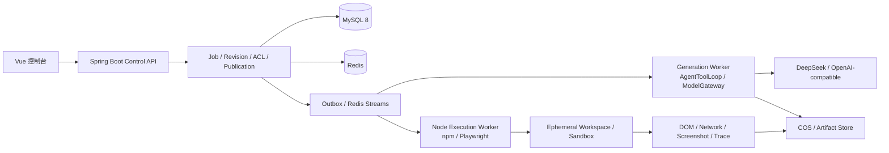

# 计划书：零代码生成平台后续改造

> 日期：2026-10-23
> 状态：Phase A、Phase B、Phase C、Phase C.5、Phase D 完成；
> Phase E 代码级沙箱完成、容器强隔离待部署环境；Phase F～G 待实施
> 来源：[plan-platform-rearchitecture.md](plan-platform-rearchitecture.md)
> 定位：本文件是后续执行和验收的唯一入口；旧计划保留当前架构与实施记录。

## 零、当前基线

- 已完成持久化 Job、Event、Outbox、SSE 重放与旧接口兼容。
- 已完成隔离 Workspace、Revision、Artifact Graph、原子发布、版本对比与回滚。
- 已完成 Lease、heartbeat、fencingToken、用户配额、重试与死信重放。
- 已完成 HTML / MultiFile / Vue StackProfile 兼容层，以及 Template、Skill 基础注册表。
- 已完成 Workspace RBAC、Asset Registry、App Analytics 事件入口和社区发布审核基础。
- 已完成三档视口 DOM 检测、截图与像素差异基础；当前浏览器仍是 Selenium。
- 已知未完成项统一由本计划管理。

## 一、结论

当前技术选型没有方向性错误，主要问题是项目已从“单用户代码生成 Demo”演进为
“持久化 Job + Revision + Team + Skill + Community 平台”，但执行面仍带有早期单体特征。

继续保留：

- Java 21 + Spring Boot 3.5：适合 Job、事务、ACL、Revision、Community 等控制面；
- Vue 3 + TypeScript + Ant Design Vue：适合管理控制台，不应为了生成 React/Next 而重写；
- MyBatis-Flex：已经深度使用，迁移 JPA/jOOQ 的收益不足以抵消成本；
- MySQL + Redis + COS：控制面事务、热状态和对象存储的职责划分基本合理；
- 自研 AgentToolLoop：预算、取消、逐文件和工具边界是平台的核心能力，不重写；
- DB Outbox/Redis Streams：当前规模足够，不提前引入 Kafka 或微服务。

需要调整：

- MySQL 5.7 已不适合作为长期平台底座；
- `spring-ai-alibaba-agent-framework` 当前未实际使用，应移除；
- AgentToolLoop 直接依赖 OpenAI 特定 Options，需要引入 ModelGateway；
- `GenerationJobRunner` 和 AgentToolLoop 仍在 API JVM 中，需要迁到独立 Generation Worker；
- Selenium、npm 和页面构建仍运行在 API 主机，需要拆成隔离的 Node Execution Worker；
- 自定义 Session + AOP 权限需要升级为显式 Spring Security 策略；
- Vue/Next 等生成运行时必须与控制台技术栈解耦；
- 浏览器、npm 和模型生成代码不能在宿主机上无限权限执行。

## 二、改造原则

1. **控制面与执行面分离，不拆微服务**：第一版仍是模块化单体 + 独立 Worker 进程。
2. **先兼容再替换**：所有执行引擎都通过 Feature Flag 灰度，旧路径至少保留一个版本周期。
3. **端口优先**：先定义 ModelGateway、BrowserVerifierPort、CommandExecutor、ArtifactStore，
   再替换具体实现。
4. **数据库是真相源**：Worker 事件、验证结果和 Artifact 必须可落库/可追踪，不能只存在日志。
5. **模型自由必须在能力目录内**：模型选择 Profile/Skill/Template，但不能自由执行 shell、
   安装任意依赖或访问宿主机。
6. **不以重写换“先进感”**：Vue 控制台、MyBatis-Flex、AgentToolLoop 和现有 Revision 模型
   均保留，只替换真正有瓶颈的边界。

## 三、目标结构



逻辑模块建议：

```text
control/
  job/
  revision/
  workspace/
  security/
  publication/
generation/
  agent/
  model/
  material/
execution/
  browser/
  build/
  sandbox/
runtime/
  html-static/
  vue-vite/
  react-vite-ts/
  next-static-export/
```

第一阶段不强制建立 Maven 多模块，可先通过 package-by-feature 收敛依赖方向；
当 Worker 真正独立部署后，再拆 Maven module。

## 四、分阶段实施

#### Phase A：依赖治理与 MySQL 8 基线（1～2 天）

状态：已完成（2026-10-24）。执行与回滚手册见
[docs/mysql8-upgrade.md](docs/mysql8-upgrade.md)。

目标：先清理确定无收益的技术债，建立可升级数据库基线。

任务：

- 删除未使用的 `spring-ai-alibaba-agent-framework` 依赖；
- 用 Maven dependency analysis 检查未声明/未使用依赖；
- 固定 Spring AI、Spring Boot、MyBatis-Flex、COS SDK 版本；
- 建立 MySQL 8 测试库，执行当时已有的全部 Flyway（当前已扩展到 V1～V15）；
- 检查 MySQL 5.7 专有行为：生成列、唯一索引中的 NULL、日期函数、排序规则和大小写；
- 评估是否将 longtext JSON 字段逐步迁移为原生 JSON；
- 记录 MySQL 5.7 → 8 的回滚窗口和备份方案。

验收：

- 后端测试全绿；
- MySQL 8 上全部迁移成功（Phase A 时为 12 个，后续新增 V13）；
- Job、Revision、Asset、Analytics、Publication 探针全通过；
- 启动后无 SQL 兼容警告；
- 依赖树中不再出现未使用的 Agent Framework。

验收结果：

- 已移除未使用的 Agent Framework，并将 Selenium 统一到 Boot BOM 管理的 4.31.0；
- 已将 Flyway 固定为 11.20.3，MySQL 8.4 启动无 SQL 兼容警告；
- 全新 MySQL 8.4 与现有 MySQL 5.7 均通过迁移和真实数据库探针；
- MySQL 5.7 仅保留“社区支持结束”提示，不影响当前兼容基线；
- 已补齐单活跃 Job、终态 Job 生成列 NULL、长文本与生产切换回滚验证；
- 原生 JSON、MySQL 8 专有语法暂不引入，保留反向逻辑恢复窗口。

#### Phase B：Spring Security 与公共接口边界（2～4 天）

状态：已完成（2026-10-24）。灰度与回滚手册见
[docs/security-migration.md](docs/security-migration.md)。

目标：保留 HttpOnly Cookie Session，但把认证、CSRF、CORS 和权限从隐式约定提升为显式策略。

任务：

- 引入 Spring Security FilterChain；
- 浏览器控制台继续使用 Session，不强行改 JWT；
- 为 Cookie 写接口启用 CSRF Token，前端请求统一附带；
- CORS 改为明确 allowlist，禁止 `* + credentials`；
- 登录成功后轮换 Session ID，修复 Session Fixation；
- 为公共 Analytics Ingest、Community 等接口规定匿名访问与限流策略；
- 将 `@AuthCheck` 逐步映射到 Spring Security authorities；
- 增加越权、CSRF、CORS、Session 固定攻击测试；
- API Token/OAuth 作为外部开放 API 的独立通道，不和控制台 Session 混用。

Feature Flag：

```text
codegen.security.spring-security.enabled=false
codegen.security.csrf.enabled=false
```

验收：

- 所有现有登录、生成、版本、团队接口行为不变；
- 缺少 CSRF Token 的 Cookie 写请求被拒绝；
- 非 allowlist Origin 被拒绝；
- Workspace 跨租户测试全部失败为拒绝；
- 公共事件接口具备速率限制和输入上限。

验收结果：

- 已引入 Spring Security，并通过 Feature Flag 保留原有 Session/AOP 回退路径；
- 浏览器控制台继续使用 HttpOnly Cookie Session，角色映射为 `ROLE_ADMIN/ROLE_USER`；
- Cookie 写接口启用 CSRF；前端自动引导 `XSRF-TOKEN` 并在 Axios/fetch 中附带请求头；
- CORS 已改为明确 allowlist，禁止通配 Origin 与凭据组合；
- 登录轮换 Session ID，登出使 Session 失效，实际冒烟确认二次登录 ID 已变化；
- 未登录、CSRF 缺失、普通用户访问管理员接口均有自动化测试；
- 公开接口、401/403 统一 JSON 响应和匿名 Analytics 限流边界已固化；
- `@AuthCheck` 与 `@PreAuthorize` 暂时共存以便灰度，稳定后再移除旧 AOP。

#### Phase C：ModelGateway、模型能力与多供应商适配（5～8 天）

状态：已完成（2026-10-24）。模型能力目录、任务路由、上下文预检、
OpenAI-compatible Adapter、生成/压缩/查询规划/视觉选片迁移、模型韧性、
统一调用审计和 Revision 模型快照均已完成；业务层旧 OpenAI Options 分支已移除。
最终实施边界见
[docs/model-gateway.md](docs/model-gateway.md)。

目标：让平台从“可修改 DeepSeek/OpenAI-compatible 模型名”升级为“可按任务选择模型、
校验模型能力、隔离供应商协议并支持可控降级”的模型执行层。

##### C.0 当前适配状态

已有的基础：

- 使用 Spring AI `ChatModel` 抽象；
- Base URL、API Key 和默认模型来自配置；
- `ReasoningProfile` 已包含 `model` 字段；
- AgentToolLoop 已集中管理预算、取消、流式聚合、工具执行和用量统计。

当前仍存在的 DeepSeek/OpenAI 假设：

- `AgentToolLoop`、`ImageMaterialPlanner`、`ContextCompressionService` 直接构造
  `OpenAiChatOptions`；
- `ImageCuratorAgent` 硬编码 `deepseek-flash`，并直接 POST `/chat/completions`；
- `WebResearchClient` 同样直接依赖 OpenAI-compatible endpoint；
- `thinking` extra body、reasoning effort 和 tool continuation 语义带有 DeepSeek 特征；
- 推理档位预算没有与模型上下文窗口、最大输出和工具能力联动；
- 视觉选片、查询规划、压缩、生成和修复没有独立的模型路由；
- AI 指标使用全局模型配置，任务实际使用的模型可能与指标不一致；
- 没有“模型是否支持 tools/vision/streaming/structured-output”的能力目录；
- 没有供应商 fallback、熔断、限流或兼容性预检。

因此当前能力边界是：

```text
可以换模型名                        部分支持
可以换 OpenAI-compatible Base URL   部分支持
不同推理档使用不同模型              配置基础已存在
不同任务使用不同模型                不完整
Anthropic/Gemini 原生协议           不支持
按模型能力选择参数                  不支持
供应商路由、降级、熔断              不支持
```

##### C.1 模型注册表与能力描述

新增 `ModelDescriptor` / `ModelRegistry`，模型配置不再只有一个字符串。

建议字段：

```text
id
provider
modelName
contextWindow
maxOutputTokens
supportsTools
supportsVision
supportsStreaming
supportsStructuredOutput
supportsReasoning
reasoningParameterStyle
inputPrice / outputPrice
enabled
```

建议任务类型：

```java
public enum ModelTask {
    GENERATE, REPAIR, MODIFY, VISION_CURATE,
    QUERY_PLAN, COMPRESS, RESEARCH
}
```

配置示例：

```yaml
codegen:
  models:
    deepseek-flash:
      provider: deepseek
      model-name: deepseek-flash
      context-window: 128000
      max-output-tokens: 65536
      supports: [tools, vision, streaming, structured-output, reasoning]
    cheap-planner:
      provider: openai-compatible
      model-name: planner-model
      context-window: 32000
      max-output-tokens: 4096
      supports: [streaming, structured-output]
  model-routes:
    generate: deepseek-flash
    repair: deepseek-flash
    vision-curate: deepseek-flash
    query-plan: cheap-planner
    compress: cheap-planner
```

##### C.2 ModelGateway 接口

```java
public interface ModelGateway {
    ModelResponse chat(ModelRequest request);

    Stream<ModelChunk> stream(ModelRequest request);
}
```

`ModelRequest` 只包含平台语义：

- task；
- messages；
- tools；
- temperature；
- 输出上限；
- reasoning preference；
- structured output schema；
- trace/call context。

`ModelResponse` 统一返回：

- 文本；
- tool calls；
- reasoning 增量；
- usage；
- finish reason；
- 实际 provider/model；
- provider 原始错误类型映射。

供应商适配器负责把平台请求转换为具体协议：

```text
DeepSeekAdapter
OpenAiCompatibleAdapter
AnthropicAdapter      后续
GeminiAdapter         后续
```

第一版必须完成：

- DeepSeek/OpenAI-compatible 适配器；
- 第二个 OpenAI-compatible 测试适配器或 mock adapter；
- 原生 Anthropic/Gemini 只保留接口契约，不立即加入生产实现。

##### C.3 供应商隔离与任务路由

任务：

- AgentToolLoop、ContextCompression、ImageMaterialPlanner、ImageCurator、WebResearch
  全部通过 ModelGateway；
- 删除业务代码中的 `deepseek-flash` 硬编码和直接 `/chat/completions` 调用；
- `OpenAiChatOptions`、thinking extra body、reasoning effort 只在 Adapter 中出现；
- 由 ModelRouter 根据 `ModelTask`、reasoning level、能力要求和可用性选择模型；
- 视觉任务必须预先校验 `supportsVision`；
- 工具任务必须预先校验 `supportsTools`；
- compression/query plan 可选择更便宜的小模型；
- 保留自研 AgentToolLoop 的预算、取消、工具执行和流式聚合；
- 将实际 provider/model、Prompt、Profile、Tool Schema 版本写入调用明细；
- 为 DeepSeek reasoning/tool continuation 建立兼容测试；
- provider 错误归一化为 retryable / terminal，并支持有限 fallback；
- 增加 circuit breaker 和模型级限流，避免单一供应商故障拖垮全部 Job。

迁移后的配置开关：

```text
codegen.model.routing.enabled=false
codegen.model.fallback.enabled=false
```

`ModelRegistry` 和 `ModelGateway` 已成为必选执行路径，不再保留关闭后直连 ChatModel 的
回退分支；单 JVM 熔断/并发状态跨实例共享留到 Phase C.5。

##### C.4 指标与审计

- `ai_call_log` 和 Prometheus 记录实际 `provider`、`model`、`model_task`；
- 指标标签保持低基数，不写模型原始响应和 Prompt 内容；
- 模型路由原因、fallback 路径和兼容性拒绝进入结构化日志；
- 每个 Job/Revision 记录模型、Profile 和路由版本，便于质量对比。

##### C.5 验收

- 只修改配置即可替换 OpenAI-compatible 供应商，不需要改 Agent 核心；
- 业务包不再 import `OpenAiChatOptions` 或直接拼接 Chat Completions URL；
- 不同任务可分别使用生成模型、视觉模型、规划模型和压缩模型；
- 视觉任务不会路由到不支持 vision 的模型；
- 工具任务不会路由到不支持 tools 的模型；
- reasoning 参数只由对应 Adapter 生成；
- token 预算根据模型上下文窗口和最大输出预检；
- 指标展示实际使用的 provider/model/task，而不是全局默认模型；
- 主模型发生限流或不可用时，可按策略 fallback 或进入明确失败；
- 同一 Prompt 在 Gateway 开关前后输出结构、工具顺序和取消语义不退化；
- DeepSeek reasoning/tool continuation 回归通过；
- 第二供应商契约测试通过，但不要求第一版覆盖所有原生供应商。

验收结果：

- 144 个默认后端测试通过，22 个外部探针按约定跳过；
- MySQL 5.7 与 8.4 均从空库执行 V1～V15，并通过 Job、ChatHistory、Artifact 与
  `ai_call_log.jobId` 持久化探针；
- 压缩、查询规划和视觉选片都通过 `AiCallListener` 写 Prometheus 与 `ai_call_log`；
- Revision Manifest 已记录路由版本、Prompt 指纹、reasoning Profile、Tool Schema 版本和实际调用；
- 真实压缩、六主题查询规划、视觉选片和 Gateway + 自管工具循环生成均通过；
- 业务代码除 OpenAI-compatible Adapter 外不再 import `OpenAiChatOptions`。

#### Phase C.5：Java Generation Worker 独立进程（3～5 天）

状态：功能完成（2026-10-24）；100 Job 并发资源曲线与 OOM 演练按计划归 Phase G。
运行、冒烟与回滚手册见
[docs/generation-worker.md](docs/generation-worker.md)。

目标：把 AgentToolLoop、模型调用、素材规划和生成阶段从 Control API JVM 中拆出，
形成独立的 `generation-worker`。这一步解决的不只是代码组织问题，而是 CPU、内存、
线程池、GC 和故障域与 API 共享的问题。

已完成边界：

- `embedded`、`api`、`worker` 三种运行模式；
- API 模式不装配 Runner、Dispatcher、Agent、模型业务入口、Vue 构建和旧 `/ai/*` 直连 Controller；
- Worker 模式使用固定大小有界线程池消费持久 Job；
- 运行中取消改为 `CANCEL_REQUESTED` + Worker 每秒轮询 + 工具边界协作退出；
- `render_fix` 状态写入 JobEvent，便于 API 只读观察；
- V15 固化 StackProfile/Skill 版本，Worker 启动前校验；
- Worker 默认不启动浏览器，不暴露业务 HTTP，只开放独立管理端口。

目标边界：

```text
control-api
  ├── 登录 / Session / RBAC
  ├── Job 创建、查询、取消
  ├── Revision 查询、发布、回滚
  ├── SSE Event View
  └── 不执行 Agent、不调用模型、不启动浏览器或 npm

generation-worker
  ├── 消费持久化 Job
  ├── AgentToolLoop / ModelGateway
  ├── 素材规划与文件生成
  ├── 写 JobEvent / Artifact
  ├── Lease 心跳与 fencing
  └── 创建候选 Revision，但不提供控制台 HTTP API

execution-worker
  ├── npm / build
  ├── Playwright / 截图 / trace
  └── 容器或轻量 VM Sandbox
```

任务：

- 将现有 `GenerationJobRunner`、`AiCodeGeneratorFacade` 的生成执行部分迁到独立启动入口；
- API 只保留 `GenerationJobService` 的创建、查询、取消和事件读取能力；
- Worker 通过 Outbox/Redis Streams 消费 Job，继续使用现有 Lease、heartbeat、fencingToken；
- Worker 与 API 使用相同 MySQL/Redis/Artifact 契约，不通过共享内存传递任务状态；
- 取消改由 `CANCEL_REQUESTED` 数据库状态和事件通知触发，Worker 在工具边界协作退出；
- `renderFixStatus` 等进程内状态迁移到 JobEvent、数据库字段或 Worker 查询接口；
- Worker 启动时校验模板、技能、StackProfile 版本与 Job 快照一致；
- API 和 Worker 分别配置 CPU、内存、并发和队列消费数量；
- Worker 提供 `/health`、`/metrics` 或独立管理端口；
- 支持 `GenerationJobEvent` 继续由 Worker 写入，API 的 SSE 只读取事件；
- Generation Worker 不得启动浏览器、执行 npm 或读取不相关工作区。

运行模式：

```text
codegen.jobs.execution-mode=embedded | api | worker
codegen.generation-worker.consumer-concurrency=2
codegen.generation-worker.lease-seconds=120
codegen.generation-worker.cancel-poll-millis=1000
```

推荐迁移顺序：

```text
API 内嵌 Runner 保持默认
→ Worker 与 API 使用同一数据库启动
→ API 切到 execution-mode=api
→ 灰度提高 Worker consumer-concurrency
→ 保留 embedded 作为应急回退
```

验收：

- API 进程不再创建 `GenerationJobRunner`、AgentToolLoop 或模型调用；
- kill Generation Worker 后，API 登录、SSE、Job 查询和取消接口不受影响；
- Worker 崩溃后 Lease 到期，任务可被另一个 Worker 接管或进入明确失败状态；
- Worker A 恢复后，因 fencingToken 失效不能继续写 JobEvent、Artifact 或 Revision；
- Worker 与 API 可分别设置 CPU/内存限额，单个 Worker 被 OOM kill 不影响 API；
- 同一 Job 不会同时产生两次有效发布；
- SSE 断开、页面刷新和 API 重启都不影响 Worker 继续执行；
- 取消请求在 Worker 的下一个工具副作用边界生效；
- 100 Job 并发下的 API/Worker 资源曲线、OOM kill 与恢复演练（Phase G）。

验收结果：

- 144 个默认后端测试通过，22 个外部探针按约定跳过；
- API 模式上下文验证不存在 `GenerationJobRunner`、`AgentToolLoop`、
  `AiCodeGeneratorFacade`、`VueBuildService` 和旧直连生成 Controller；
- Worker 模式上下文验证完整消费链和健康指示器存在；
- MySQL 5.7 与 8.4 均通过 V1～V15，并验证 `WAITING_RETRY` Job 可重新 claim；
- 真实同库双进程启动：API 8130/管理 8131，Worker 仅管理 8132；
- API 模式旧 `/ai/chat` 返回 404；杀死 Worker 后 API 健康仍为 UP；
- Worker 并发有界、Lease 续租和 fencing 逻辑沿用已通过的 Job 持久化机制；
- 浏览器验证暂由 Phase D 的 Execution Worker 接管，Worker 通过启动校验禁止误开。

#### Phase D：Playwright Node Execution Worker（5～8 天）

状态：已完成（2026-10-24）。HTML/MultiFile/Vue 均完成三档真实验证。
运行手册见 [docs/browser-worker.md](docs/browser-worker.md)。

目标：将浏览器验证从 API JVM 拆出，先解决能力和稳定性，再解决强沙箱。

建议 Worker 契约：

```json
{
  "jobId": "469...",
  "revisionId": "42...",
  "sourceUri": "file-or-cos://...",
  "viewports": [1440, 768, 375],
  "checks": ["dom", "console", "network", "screenshot", "trace"],
  "egressPolicy": "generated-app"
}
```

Worker 输出：

```text
verify-report.json
network-failures.json
console-errors.json
screenshots/desktop.png
screenshots/tablet.png
screenshots/mobile.png
trace.zip
```

任务：

- Node Worker 使用 Playwright；
- Java 侧定义 `BrowserVerifierPort`，Selenium 和 Playwright 均为适配器；
- 通过现有 Outbox/Redis Streams 下发验证任务；
- Worker 不直接写 MySQL，只上传 Artifact 并回传结构化结果；
- 支持 network failed、CORS、4xx/5xx、console、overflow、broken image、blank page；
- 保留现有 Selenium 实现作为 Feature Flag 回退；
- 将截图、trace、报告登记到 Revision Artifact Graph。

已完成：

- `BrowserVerifierPort` + Selenium/Playwright 双 Adapter；
- 独立 `browser-worker` Node 服务，使用 `playwright-core` 和 Edge channel；
- Worker 内一次性 `127.0.0.1` 静态服务器，避免 `file://` 误报；
- console、pageerror、request failed、HTTP 4xx/5xx、CORS 信号、图裂、溢出、空白页；
- 三档截图、network/console JSON、Playwright trace；
- Revision 登记 `BROWSER_TRACE_*`、`NETWORK_FAILURE_*`、`CONSOLE_ERROR_*`；
- Worker 工作区根目录限制、1MB 请求上限、最多 5 视口；
- API 模式不装配 `BrowserVerifierPort`；Generation Worker 禁止本地 Selenium。

尚未完成：

- 无 Phase D 阻塞项。React/Next 构建与验证属于 Phase F。

Feature Flag：

```text
codegen.browser.engine=selenium | playwright
codegen.browser.playwright.url=http://127.0.0.1:8090
codegen.browser.playwright.transport=http | redis
codegen.browser.playwright.connect-timeout-ms=3000
codegen.browser.playwright.read-timeout-ms=120000
```

验收：

- HTML/Multi/Vue 三类应用都能完成三档验证；
- 与 Selenium 基线对比，核心问题检出率不下降；
- Worker 崩溃不会卡死 Job；
- 同一报告可追溯到 Job/Revision/Artifact；
- API JVM 不再创建浏览器进程。

验收结果：

- Selenium/Playwright 返回同一 `RenderReport`，生成修复链路不变；
- Playwright 真实问题页在 desktop/tablet/mobile 三档均检出图裂和横向溢出；
- Java Adapter 真实调用 Node Worker 成功，返回截图和 trace；
- Redis Streams 端到端探针通过：Java 入队、Node 消费、结果键回写、Java 解析；
- Worker 不可用时返回 unusable report，不阻塞生成发布；
- API 边界测试确认不装配 `BrowserVerifierPort`；
- 普通静态 HTML 与 MultiFile 使用同一验证路径；
- Vue 先执行隔离 npm build，再对 dist 完成 desktop/tablet/mobile 三档真实验证；
- Vue 构建失败会保留明确失败原因，不把未构建源码误报为视觉问题。

#### Phase E：隔离 Build / Browser Sandbox（5～10 天）

状态：代码级隔离与配额完成（2026-10-24）；当前机器无 Docker/WSL/Podman，
容器/轻量 VM 强隔离仍需部署环境支持。执行边界见 [docs/sandbox.md](docs/sandbox.md)。

目标：防止模型生成代码与 npm 依赖获得宿主机权限。

任务：

- 每次执行使用独立临时 workspace；
- 构建和浏览器运行进入容器或轻量 VM；
- 限制 CPU、内存、执行时长、进程数与临时盘；
- 默认无宿主机目录挂载，仅挂载当前 Revision 的临时副本；
- 网络默认拒绝，仅允许 npm registry、已审核 CDN 和图片域名；
- npm 使用 lockfile、registry proxy、依赖 allowlist；
- 禁止访问云元数据地址、内网段和本地管理端口；
- Worker 进程退出后强制清理 workspace；
- 记录 build/verify 的资源消耗与超时原因。

已完成：

- Vue 构建复制到独立临时目录，成功后才替换 live `dist`；
- package-lock 强制、依赖 allowlist、build script allowlist、默认禁用 npm scripts；
- 源码/产物文件数与大小上限，拒绝符号链接；
- 有界 stdout/stderr、命令超时、进程树递归回收；
- 剔除密钥/云/数据库环境变量，隔离 TEMP 与 npm cache；
- Browser Worker 真实路径解析、egress host allowlist、云元数据阻断；
- Browser 单次硬超时与 source/output/runtime 指标；
- Build/Browser 执行报告落盘。

未完成：

- cgroup CPU/内存/PID 配额；
- 容器只读 rootfs 与网络 namespace；
- npm install script 的内核级隔离。

验收：

- 恶意 `../../`、绝对路径、内网 URL、云元数据地址被拒绝；
- 无限循环、巨量文件、超大依赖和 fork bomb 能在配额内终止；
- Worker 超时后主 API 不受影响；
- 旧 Worker 无法覆盖新 Revision（继续使用 fencingToken）。

验收结果：

- 未知依赖、任意 build shell 命令和缺失 lockfile 均被拒绝；
- 源码文件数超限被拒绝；
- 真实 Vue 工程在隔离目录完成 npm install/build，并清理沙箱；
- Playwright 对 `169.254.169.254` 返回 `EGRESS_BLOCKED`；
- Build/Browser 均记录耗时、文件大小、超时和资源摘要；
- fencingToken 与 Revision CAS 沿用既有真实探针；
- 容器内核级隔离明确保留为部署前置条件，未伪装为已完成。

#### Phase F：React / Next 运行时落地（5～8 天）

目标：让模型真正选择现代技术栈，而不是只是注册一个不可用 Profile。

任务：

- 先完成 `react-vite-ts`，再完成 `next-static-export`；
- 每个 Profile 提供脚手架、依赖 allowlist、Prompt、build、preview、deploy、verify；
- Next 第一版只支持静态导出，不引入每应用一个 SSR 进程；
- 扩展 CodeGenTypeEnum 兼容层或引入 RuntimeType，但禁止在 Facade 中继续加 switch；
- 将 build/preview/deploy 从固定枚举分支迁到 StackProfile；
- 用固定评估集比较 Vue、React、Next 的 token、耗时、验证通过率和人工评分；
- 只有通过质量门禁的 Profile 才能从 unavailable 改为 available。

Feature Flag：

```text
codegen.runtime.react-vite-ts.enabled=false
codegen.runtime.next-static-export.enabled=false
```

验收：

- React/Next 与 HTML/Vue 走同一 Job/Revision/Artifact/Verify；
- 模型不能提交任意 shell 或未注册依赖；
- 不兼容 Profile 在 Plan 阶段被拒绝；
- 同一 Revision 可以稳定重建和回滚。

#### Phase G：质量门禁与规模数据（持续）

目标：把“看起来能用”提升为可量化的工程质量。

任务：

- 在真实模型上执行 20 条固定评估集并保存基线；
- 建立 build、render、token、耗时、修复轮次和人工 rubric；
- 模板增加 Golden Screenshot 与 layout regression；
- Analytics 仅在高数据量时迁移 ClickHouse，当前继续 MySQL；
- 引入 OpenAPI 生成前端 client，减少手写 API drift；
- 用实际并发压测验证 100 Job、队列积压、死信、Worker 接管和内存占用。

## 五、明确不做

- 不把 Vue 控制台重写成 React；
- 不把 MyBatis-Flex 重写成 JPA；
- 不重写 AgentToolLoop；
- 不立即拆微服务；
- 不立即引入 Kafka；
- 不在第一阶段实现 Next SSR；
- 不在没有质量门禁时把 React/Next 标记为 available；
- 不继续把 npm、浏览器和生成代码直接运行在 API 宿主机。

## 六、关键改造顺序

```text
依赖治理
→ MySQL 8
→ Spring Security / CSRF / CORS
→ ModelGateway
→ Java Generation Worker
→ Playwright Browser Worker
→ Build/Browser Sandbox
→ React/Next StackProfile
→ Golden 质量门禁与规模压测
```

## 七、最终验收指标

- 现有 99+ 默认测试持续全绿；
- MySQL 8 完成全量迁移与回滚演练；
- 未授权、CSRF、CORS、跨 Workspace 全部拒绝；
- Agent 核心不依赖供应商 SDK 特定 Options；
- 模型注册表、能力校验、任务路由和实际 provider/model 指标可工作；
- OpenAI-compatible 模型换供应商只需配置，原生供应商通过 Adapter 扩展；
- API 进程不执行 Agent、不启动浏览器和 npm；
- Generation Worker、Browser/Build Worker 可分别限制资源并独立扩容；
- React/Next 只通过 Profile 扩展，不修改 Job/Revision/SSE 核心；
- 20 条固定 prompt 有真实基线报告；
- 100 并发任务下 API 快速入队、队列可观测、失败可重试或进入死信。

## 八、未完成的扩展能力

以下能力不作为控制面/执行面拆分的前置阻塞项，但在核心 Worker 稳定后需要继续实施。

### 8.1 真实模型评估基线

状态：评估集已建立，真实运行与报告未开始。

任务：

- 为 20 条固定 prompt 建立离线 Evaluation Runner；
- 每条需求记录 Profile、Template、Skill、模型和 reasoning level；
- 采集 build 状态、三视口验证、图片问题、token、耗时、修复次数；
- 输出机器可读 JSON 与可比较的 Markdown 报告；
- 建立人工 rubric：信息层级、视觉完成度、内容匹配、响应式、可交互性；
- 把结果保存到带日期/模型/版本号的 baseline 文件。

验收：

- 同一版本可重复运行并生成稳定格式报告；
- Prompt、模型或模板升级后能进行前后对比；
- 不以单次主观截图作为质量结论。

### 8.2 BackendRuntimeProfile 基础

状态：未开始。不属于前端 StackProfile。

范围：

- App 数据存储；
- App 终端用户与登录；
- SecretReference 与密钥管理；
- Serverless Function；
- Scheduled Job。

任务：

- 定义 `BackendRuntimeProfile` 和 Capability Contract；
- App 数据使用 workspaceId + appId 双隔离；
- 密钥只保存 SecretReference，不进入源码、Prompt、日志和 Artifact；
- Function/Schedule 必须依赖低权限 Sandbox、超时、配额、幂等和死信；
- 先实现能力声明和禁用目录，确认安全模型后再开放执行。

验收：

- 生成前端无法读取数据库凭据或 Secret 原值；
- 跨 App 数据访问被拒绝；
- 未启用 BackendRuntimeProfile 的应用不能创建函数、密钥或定时任务；
- 函数版本与 App Revision 一起发布和回滚。

### 8.3 Asset Processor

状态：上传与内容寻址已完成，处理链未开始。

任务：

- 图片缩略图、640/1280/2400、WebP/AVIF；
- 视频 poster、时长、转码与流式播放；
- 音频时长、波形与预览；
- 3D 模型缩略图和格式校验；
- 字体许可证与格式检查；
- COS/S3 ArtifactStore 适配；
- 素材引用检查、删除保护和版权元数据。

验收：

- 处理器失败不破坏原素材；
- App/Publication 删除前能检查素材引用；
- 同一内容不重复上传和处理；
- 生成页面引用 assetId，发布时解析为当前 CDN URL。

### 8.4 Skill 工具权限真正生效

状态：技能注册、Profile 兼容和 Prompt 注入已完成，allowedTools 尚未裁剪执行工具。

任务：

- AgentToolLoop 根据当前 Skill 集合计算工具交集；
- Skill 未声明的工具不注册给模型；
- 工具风险等级与 Skill permission 同时校验；
- tool call 命中越权能力时返回结构化拒绝；
- 将实际暴露工具集合写入 AI 调用明细和 Revision Manifest。

验收：

- 只启用 `seo-audit` 时无法调用图片、Web 或代码执行类工具；
- 模型伪造工具名也无法绕过注册表；
- 技能冲突和缺权限在 Job 创建时拒绝。

### 8.5 Workspace 团队完善

状态：RBAC、成员直加、审计基础已完成。

任务：

- Workspace Invitation token 与接受/拒绝流程；
- 邀请过期、撤销和重复邀请处理；
- App 级细粒度 ACL；
- 团队审计查询 API；
- 成员停用/恢复和所有权转移；
- 团队生成前的默认 Workspace 选择与配额。

验收：

- 未接受邀请不能访问 Workspace；
- 被移除成员的 Session 在下一次权限判断时立即失效；
- OWNER 不可被直接移除；
- 所有成员和权限变更可审计。

### 8.6 App Analytics Dashboard

状态：事件摄入和日聚合 API 已完成，前端与采样未开始。

任务：

- 前端流量 Dashboard；
- 按日期、eventName、Revision 的趋势图；
- 版本发布前后对比；
- 采样、数据保留和敏感字段过滤；
- 资源失败与 conversion 漏斗；
- 高数据量后再评估 ClickHouse，当前不提前引入。

验收：

- Dashboard 不展示敏感字段；
- Analytics 写入失败不影响生成页面；
- Revision 发布与流量变化可关联；
- 聚合查询在目标数据量下有明确延迟指标。

### 8.7 Community 完善

状态：Revision publication、审核、公开列表和下架基础已完成。

任务：

- Fork / Remix：从公开 Revision 创建独立 App 和初始 Revision；
- 来源 App/Revision/Template/Asset 和 License 引用记录；
- 评论、评分、举报、版权申诉和审核队列；
- 社区模板版本兼容声明；
- Takedown 后禁止继续复制，同时不破坏已合法部署用户；
- 评分不能替代自动验证。

验收：

- Fork 记录完整来源链；
- 未授权素材不能通过 Remix 绕过 License；
- 下架与删除策略符合引用关系；
- 公共内容和私密 Workspace 数据严格隔离。

### 8.8 运营与压测

状态：未开始。

任务：

- 100 Job 并发、持续 30 分钟压测；
- Worker 扩张、队列积压、死信、租约接管测试；
- Generation/Browser/Build Worker 独立资源曲线；
- API、MySQL、Redis、COS 故障注入；
- 数据备份、恢复和迁移演练；
- 成本指标：模型 token、浏览器时长、构建时长、存储占用。

验收：

- 单 Worker 崩溃不会导致 API 不可用；
- 队列积压有告警和限流反馈；
- 所有任务最终进入成功、失败或死信，不存在永久中间态；
- 能从备份恢复 Job、Revision 和 Artifact 引用。

### 8.9 建议执行顺序

核心执行面稳定前：

```text
8.1 评估基线
→ 8.4 Skill 工具权限
→ 8.5 团队邀请与 ACL
```

执行 Worker 稳定后：

```text
8.3 Asset Processor
→ 8.6 Analytics Dashboard
→ 8.7 Community 完整能力
→ 8.2 BackendRuntimeProfile
→ 8.8 规模压测与运营
```
